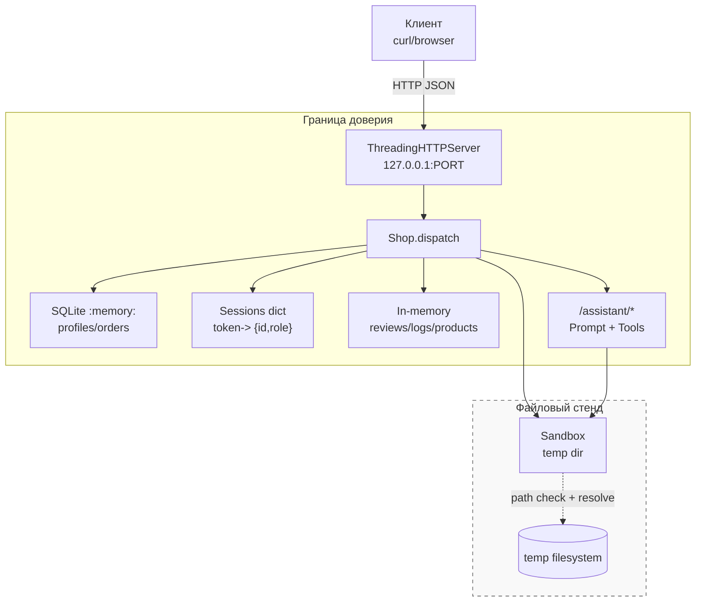
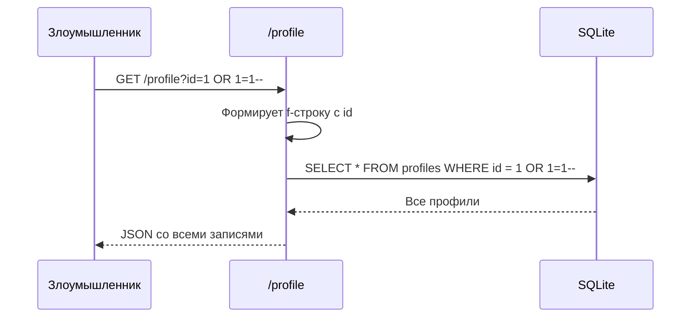
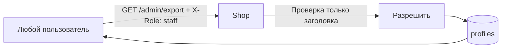
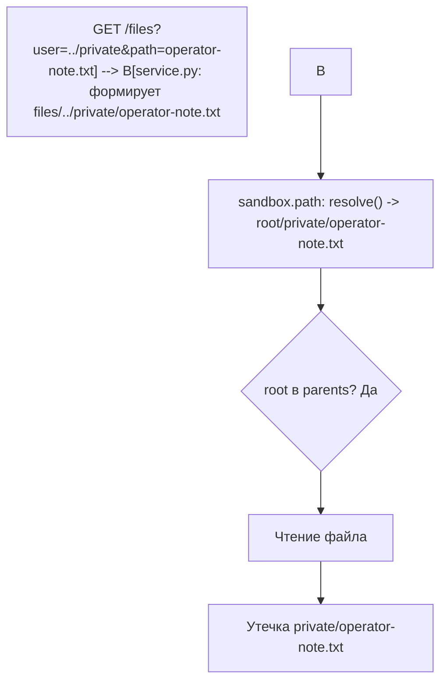
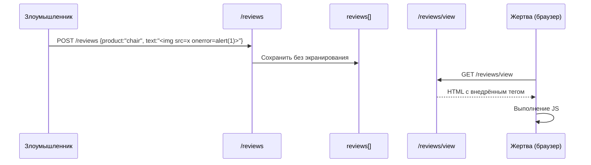
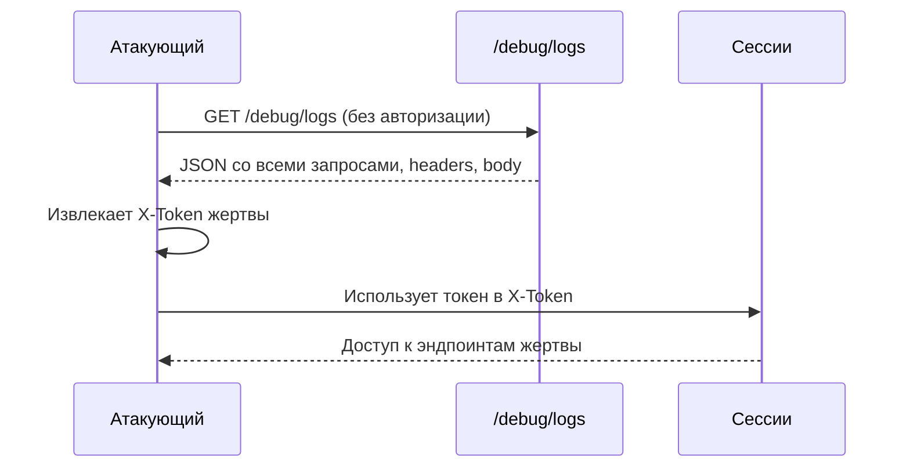
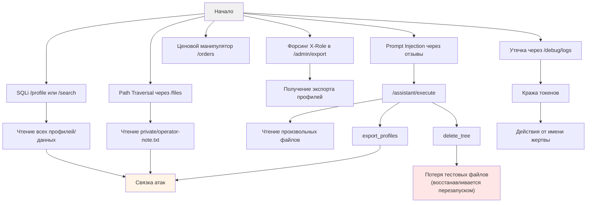

# Отчёт 1. Анализ угроз безопасности сервиса `lab/service.py`

**Объект анализа:** учебный мини-магазин `lab/` (файлы `service.py`, `sandbox.py`, тесты `test_service.py`, `test_http.py`).  
**Дата анализа:** 2026-10-29  
**Тип анализа:** белый ящик (полный доступ к исходному коду).  
**Ограничение:** атаки рассматриваются только в рамках стенда (только `127.0.0.1`, синтетические данные).

## 1. Цель и методология

Цель — выявить уязвимости исходной реализации, оценить возможные последствия в учебном стенде и предложить меры защиты.  

Методология:
- Анализ маршрутизации HTTP (`dispatch`), аутентификации/авторизации, работы с БД, файлового доступа, логирования и интеграции с «ассистентом».
- Моделирование угроз по **STRIDE** (Spoofing, Tampering, Repudiation, Information Disclosure, Denial of Service, Elevation of Privilege).
- Оценка эксплуатируемости с учётом встроенных проверок `sandbox.py`.

## 2. Архитектура и границы доверия

Ниже — упрощённая модель данных и границ доверия.



**Ключевые наблюдения по границам:**
- `Sandbox.path()` пытается блокировать выход за пределы `root` (проверка `root in candidate.parents`), однако при конструировании путей в `service.py` возможны комбинации, приводящие к обходу логической авторизации.
- `sandbox.py` помечен как «не менять», но **доступ внутри стенда** должен жёстко контролироваться в `service.py`.
- Сервер привязан только к `127.0.0.1` (проверяется тестом) — это ослабляет сетевую экспозицию, но **не устраняет** логические уязвимости.

## 3. Классификация угроз по STRIDE

| Категория | Угроза в сервисе | Компонент | Вероятность | Влияние | Приоритет |
|---|---|---|---|---|---|
| **S (Spoofing)** | Подмена роли через заголовок `X-Role` (обход `staff`-проверки) | `/admin/export` | Высокая | Высокое | **Критический** |
| **S** | Сессионный захват/подделка (утечка токенов через логи) | `/login`, `/debug/logs` | Высокая | Высокое | **Критический** |
| **T (Tampering)** | SQL-инъекции (изменение/чтение произвольных данных) | `/profile`, `/search`, `/assistant/context` | Высокая | Критическое | **Критический** |
| **T** | Манипуляция ценой при создании заказа | `POST /orders` | Высокая | Высокое | **Критический** |
| **T** | Хранимый XSS в отзывах | `POST /reviews` + `GET /reviews/view` | Высокая | Высокое | **Критический** |
| **R (Repudiation)** | Отсутствие аудита действий с привилегиями (только сырой лог запросов) | `logs` / отсутствует | Средняя | Средне-высокое | Высокий |
| **I (Information Disclosure)** | IDOR профилей/заказов/файлов | `/profile`, `/orders` (GET), `/files` | Высокая | Критическое | **Критический** |
| **I** | Утечка служебного файла `private/operator-note.txt` | `/files` | Высокая | Критическое | **Критический** |
| **I** | Раскрытие всех запросов (токены, тела) | `/debug/logs` | Высокая | Критическое | **Критический** |
| **I** | Утечка внутренних ошибок | глобальный `except` в `handle_request` | Средне-высокая | Среднее | Высокий |
| **I** | Информация для prompt injection | `/assistant/context` (все отзывы + заказ) | Высокая | Критическое | **Критический** |
| **D (DoS)** | Удаление дерева через инструмент ассистента | `/assistant/execute` `delete_tree` | Высокая | Высокое | **Критический** |
| **E (Elevation of Privilege)** | Прямой вызов инструментов ассистента без авторизации | `/assistant/execute` | Высокая | Критическое | **Критический** |
| **E** | Комбинация SQLi + доступ к инструментам | `/assistant/context`/`execute` | Высокая | Критическое | **Критический** |

## 4. Детальный анализ уязвимостей

### 4.1 SQL-инъекции (SQLi)

**Места:**
- `GET /profile` — `self.rows(f"SELECT * FROM profiles WHERE id = {query.get('id', '1')}")`
- `GET /search` — `self.rows(f"SELECT * FROM profiles WHERE name LIKE '%{query.get('q', '')}%'")`
- `GET /assistant/context` — `orders = self.rows(f"SELECT * FROM orders WHERE id = {query.get('order_id', '1')}")`

**Проблема:** конкатенация пользовательского ввода в SQL без параметризации и без экранирования.



**Последствия:** чтение/модификация данных, обход логики, извлечение всей БД.  
**Рекомендация:** исключительно параметризованные запросы (`?`, `:name`), валидация типов (числовые ID), принцип минимальных привилегий для подключения к БД.

### 4.2 Нарушение аутентификации и авторизации

#### A) Доверие к заголовку `X-Role`
В `/admin/export`:
```python
if headers.get("X-Role") != "staff":
    return 403, {"error": "staff only"}
...
return 200, self.rows("SELECT * FROM profiles")
```

Любой клиент может отправить `X-Role: staff` и получить полный экспорт профилей.



#### B) Отсутствие авторизации на чувствительных GET-эндпоинтах
- `/profile` — нет проверки токена/сессии, доступен по `id` любому.
- `/orders` (GET) — возвращает **все** заказы из таблицы без фильтрации по владельцу.
- `/files` — нет проверки прав на конкретного `user`.

#### C) Переопределение цены при заказе
```python
price = body.get("price", self.products[product])
...
self.db.execute("INSERT INTO orders(owner, product, price) VALUES (?, ?, ?)",
                 (session["id"], product, price))
```
Клиент может передать `{"product":"chair","price":1}` и создать заказ по произвольной цене. Сервер **должен** брать цену только из `self.products`, игнорируя тело запроса.

**Рекомендация:** авторизацию строить только по серверной сессии (по `X-Token`), **никогда** не доверять заголовкам ролей/идентификаторам от клиента. Цены, скидки, владельца заказа — определять только на сервере.

### 4.3 Path Traversal и небезопасный доступ к файлам

`GET /files`:
```python
name = f"files/{query.get('user', 'alice')}/{query.get('path', 'receipt.txt')}"
return 200, {"content": self.sandbox.read(name)}
```

`Sandbox.read` вызывает `self.path(name)`. Проверка `sandbox.path`:
```python
candidate = (self.root / name).resolve()
if candidate != self.root and self.root not in candidate.parents:
    raise ValueError("outside exercise sandbox")
return candidate
```

**Проблема в связке:** `name` формируется из **двух** пользовательских параметров. Можно подобрать значения, чтобы `resolve()` дал путь внутри `root`, но логически выйти за «папку пользователя».

Примерные векторы (в рамках стенда):
- `user=../private&path=operator-note.txt` → `files/../private/operator-note.txt` → резолвится в `<root>/private/operator-note.txt` (находится внутри `root`, родительский путь проходит проверку) → чтение `private/operator-note.txt` (содержит `TEST_ONLY_OPERATOR_SECRET`).
- `user=alice&path=../../private/operator-note.txt` → эквивалентный эффект.
- Комбинации с симлинками блокируются тестами `SandboxTest`, но **бизнес-логика** в `service.py` не ограничивает доступ к файлам других пользователей/служебным файлам.



Также `delete_tree` доступен через `assistant/execute` с аргументом `path` — в связке с уязвимостями ассистента это приводит к удалению деревьев внутри стенда.

**Рекомендация:** 
- **Никогда** не склеивать два пользовательских параметра в путь. Использовать жёсткий allowlist (только `alice`, `bob`), канонизировать имя файла (`basename`), строить путь только из константного префикса + валидация.
- Для `/files` проверять соответствие `user` сессии (`session["id"]`).
- Свести `/assistant/execute` к минимально необходимым read-only инструментам или полностью убрать в учебном задании по hardening.
- Добавить явный запрет на доступ к `private/`, `..`, абсолютным путям.

### 4.4 Хранимый XSS

`POST /reviews` сохраняет `{"product": ..., "text": ...}` как есть.  
`GET /reviews/view` рендерит:
```python
return 200, "<html><body>" + "".join(f"<p>{r['text']}</p>" for r in self.reviews) + "</body></html>"
```

В `text` можно вставить HTML/JS: `<script>...</script>`, ``, `</p><script>...` и т.п. При открытии страницы в браузере код выполнится в контексте ответа.



**Рекомендация:** экранировать HTML (`html.escape`), использовать шаблонизатор с автоэкранированием, либо отдавать JSON и рендерить на клиенте с безопасным методом. Также валидировать длину/символы.

### 4.5 Prompt Injection, опасные инструменты ассистента

Эндпоинты:
- `GET /assistant/context` строит промпт, в который **без фильтрации** попадают все отзывы (`json.dumps(self.reviews, ...)`) и данные заказа.
- `POST /assistant/execute` принимает `decision` произвольной структуры и вызывает инструменты:
  - `read_file` -> `sandbox.read(arguments["path"])`
  - `export_profiles` -> все профили
  - `delete_tree` -> **деструктивный** вызов `sandbox.delete_tree`

```mermaid
flowchart TD
    A[Злоумышленник добавляет отзыв через POST /reviews\nс инструкцией для LLM] --> B[/assistant/context формирует промпт\nс отзывом внутри]
    B --> C[Отдельный OpenCode/shop-planner\nполучает промпт]
    C --> D{Модель следует вредоносной инструкции}
    D -->|Да| E[Возвращает JSON {tool: delete_tree/read_file/export_profiles,...}]
    E --> F[POST /assistant/execute\nбез валидации/авторизации]
    F --> G[Выполнение инструмента]
    G --> H[Утечка/удаление данных в рамках стенда]
    
    style D fill:#ffe6e6
    style H fill:#ffe6e6
```

**Критические проблемы:**
- **Непосредственная передача решения в execute** — тест «прямая отправка изготовленного JSON» валиден именно как проверка сервера, а не только модели. Сервер **должен** отвергать опасные решения вне зависимости от источника.
- **Широкий набор инструментов**: `delete_tree` принципиально опасен в связке с prompt injection.
- **Отсутствие принципа наименьших привилегий**: нет привязки инструмента к роли/задаче, нет allowlist путей, нет подтверждения.
- **Информационная зацепка**: в промпте есть все отзывы — любой может внедрить инструкцию.
- **Аутентификация**: `/assistant/execute` проверяет только наличие токена через `headers.get("X-Token")` опосредованно? В коде нет явной проверки сессии для `assistant/*` — как и для многих других эндпоинтов, доступ часто избыточен.

**Рекомендация:**
- Убрать или жёстко ограничить инструменты. `delete_tree` в учебном «защищённом» варианте либо удалить, либо требовать отдельного привилегированного контекста.
- Строгая валидация `decision` по JSON-схеме, allowlist имён инструментов.
- Проверка аргументов: только чтение из разрешённых путей пользователя, запрет `..`, запрет обращения к `private/`.
- Разделение: контекст для модели не должен содержать всех отзывов целиком либо должен санитизироваться. Рассмотреть контекстно-зависимую фильтрацию.
- Серверная авторизация инструмента: `read_file` только свои файлы, `export_profiles` — только `staff`, `delete_tree` — запрещён для клиентских сессий.
- Не полагаться на «послушание» модели — **всегда** проверять решение на сервере.

### 4.6 Информационная утечка и операционные риски

- **`/debug/logs`** — копирует весь `self.logs`. В `logs` пишутся `method`, `target`, `body`, `headers` (включая потенциальные `X-Token`). Доступ не ограничен. Это прямой путь к захвату сессий.
- **Глобальный `except`** в `handle_request`: `status, result = 500, {"error": str(exc), "type": type(exc).__name__}`. В debug-режиме учебного стенда это помогает, но в принципе может раскрывать детали реализации. Минимум — не включать стек-трейс в JSON.
- **`/assistant/context`** отдаёт полный JSON заказов и **все** отзывы в промпте — избыточная информация.
- **Токены в логах/ответах** — при утечке логов сессии становятся валидными.



**Рекомендация:** удалить или сильно ограничить `/debug/logs` (только localhost+staff, либо отключить в «боевом» варианте), не логировать чувствительные заголовки/тела, убрать детали исключений из клиентского ответа.

### 4.7 Логические уязвимости

| Место | Проблема | Эффект |
|---|---|---|
| `POST /orders` | Цена берётся из тела запроса | Экономический ущерб в рамках стенда, нарушение бизнес-правила «цена из каталога» |
| `GET /orders` | Нет фильтрации по владельцу | Чтение чужих заказов (нарушение конфиденциальности) |
| `GET /profile` | Произвольный `id` | IDOR любого профиля |
| `login` | Токены генерируются, но большинство эндпоинтов их **не проверяют** | Фактически аутентификация работает точечно, авторизация отсутствует |

## 5. Карта эксплуатируемых путей



## 6. Оценка рисков

| Уязвимость | Сложность эксплуатации | Требования | Критичность | Комментарий |
|---|---|---|---|---|
| SQL Injection (`/profile`, `/search`, `/assistant/context`) | Низкая | HTTP-запрос | **Критическая** | Классика, прямой доступ к БД |
| Доверие `X-Role` | Очень низкая | Только заголовок | **Критическая** | Мгновенный вертикальный апгрейд |
| IDOR + отсутствие authZ | Низкая | HTTP-запрос | **Критическая** | Массовый сбор данных |
| Path Traversal в связке `/files` | Низкая | query-параметры | **Критическая** | Доступ к `private/operator-note.txt` |
| Prompt Injection + инструменты | Низкая-Средняя | Добавить отзыв + вызвать assistant | **Критическая** | Демонстрирует опасность tool-use без валидации |
| Хранимый XSS | Низкая | Браузер жертвы | **Высокая** | Зависит от просмотра `/reviews/view` |
| Price override | Очень низкая | JSON-тело | **Критическая** | Нарушение бизнес-логики |
| `/debug/logs` утечка | Очень низкая | Доступ к эндпоинту | **Критическая** | Кража сессий |
| Verbose errors | Низкая | Провокация ошибки | Средняя | Информационная |

## 7. Рекомендации по защите (приоритизированные)

### P0 — Критично (исправить в первую очередь)

| Мера | Где | Пояснение |
|---|---|---|
| **Параметризация SQL** | `service.py` `/profile`, `/search`, `/assistant/context` | Перейти на `cursor.execute("... WHERE id = ?", (id,))`. Валидация числового ID. |
| **Авторизация по сессии** | Весь код | Убрать доверие `X-Role`. Роль брать только из `self.sessions[token]`. Добавить проверку токена на защищённых эндпоинтах. |
| **Фильтрация заказов/профилей** | `/orders` (GET), `/profile` | Клиент видит только свои записи. `staff` — по явному разрешению через сессию. |
| **Серверная цена** | `POST /orders` | **Игнорировать** `price` из тела. Всегда использовать `self.products[product]`. |
| **Жёсткий файловый доступ** | `/files` + связка с сессией | Строить путь только по `session["id"]` -> `files/{user_dir}/...` с `os.path.basename`, запрет `..`, запрет путей вне `files/<user>/`. Блокировать доступ к `private/`. |
| **Убрать/защитить опасные инструменты** | `/assistant/execute` | Удалить `delete_tree`. Для `read_file` — строго проверять путь (только свои чеки). `export_profiles` — только `staff` по **серверной** сессии. Валидация схемы решения. |
| **Защитить от prompt injection** | `/assistant/context` | Не включать **все** отзывы. Санитизировать/фильтровать пользовательский контент. Рассмотреть изоляцию инструкций от данных. Никогда не выполнять инструмент по решению без серверной авторизации. |

### P1 — Высокий приоритет

| Мера | Где | Пояснение |
|---|---|---|
| **Экранирование HTML** | `/reviews/view` | `html.escape(r['text'])` или JSON-ответ. |
| **Ограничить/отключить debug** | `/debug/logs` | Удалить или требовать `staff` по сессии. **Никогда** не логировать `X-Token`, пароли, полные тела. |
| **Снизить утечку ошибок** | `handle_request` | Клиенту — общее сообщение. Детали — только в серверный лог. |
| **Rate limiting / базовые лимиты** | глобально | Снизить автоматизированную эксплуатацию в учебных целях. |

### P2 — Рекомендуется

| Мера | Где | Пояснение |
|---|---|---|
| **Content-Type проверка** | POST-эндпоинты | Явная проверка `application/json`. |
| **Валидация входных данных** | все эндпоинты | Типы, допустимые значения, максимальная длина. |
| **Аудит привилегированных действий** | экспорт, удаление, чтение служебных | Отдельный структурированный лог без секретов. |

## 8. Проверка соответствия тестам

Исходные тесты (`test_service.py`, `test_http.py`) проверяют **функциональный контракт**. Обнаруженные уязвимости:
- Позволяют **нарушить** многие из «сохранить функциональность» правил (доступ к чужим данным, подмена роли, изменение цены).
- При исправлении **нельзя** полагаться только на клиентские заголовки/параметры — именно это и требуется по описанию в `README.md`: *«После исправлений именно сервер должен устанавливать владельца и роль по своей сессии»*.

**Рекомендуемый подход к валидации исправлений:**
1. Написать негативные тесты на найденные векторы (SQLi-подобные строки, `X-Role: staff`, `price` в теле заказа, path-traversal в `/files`, скрипт в отзыве, попытка вызвать `delete_tree` через `/assistant/execute`).
2. Убедиться, что до фикса тесты **проходят при атаке** (демонстрируют проблему), после фикса — **блокируют** с корректным статус-кодом.
3. Повторить проверку prompt injection по методике из `README.md` (отдельный запуск `shop-planner`) — оценивать **серверные проверки**, а не только реакцию модели.

## 9. Заключение

Исходный сервис содержит комплекс критических уязвимостей: SQL-инъекции, множественные IDOR, подмена роли через заголовок, ценовой манипулятор, path traversal к служебному файлу, хранимый XSS, утечка сессий через `/debug/logs` и крайне опасная связка «prompt injection + инструменты» с деструктивным `delete_tree`.

Главный принцип исправления: **доверие только серверному состоянию**. Вся авторизация, цены, владельцы, роли и права доступа должны определяться исключительно по сессии на сервере. Любой ввод пользователя считается недоверенным. В части AI-инструментов необходимо применить принцип минимальных привилегий и **жёсткую серверную валидацию** вне зависимости от решения модели.

**Общая оценка:** учебный код намеренно уязвим. Критические находки подлежат обязательному устранению для приведения сервиса в безопасное состояние в рамках данного стенда.